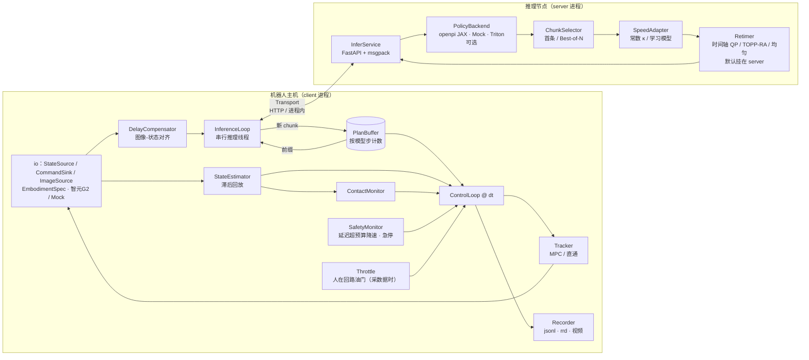
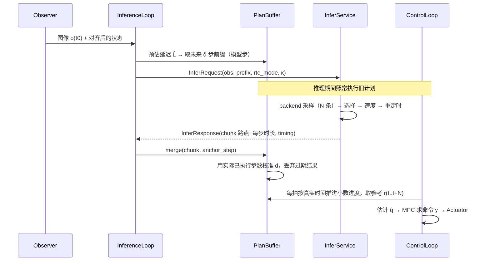
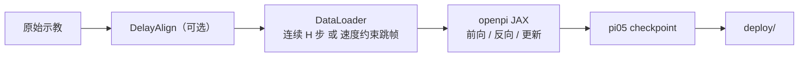
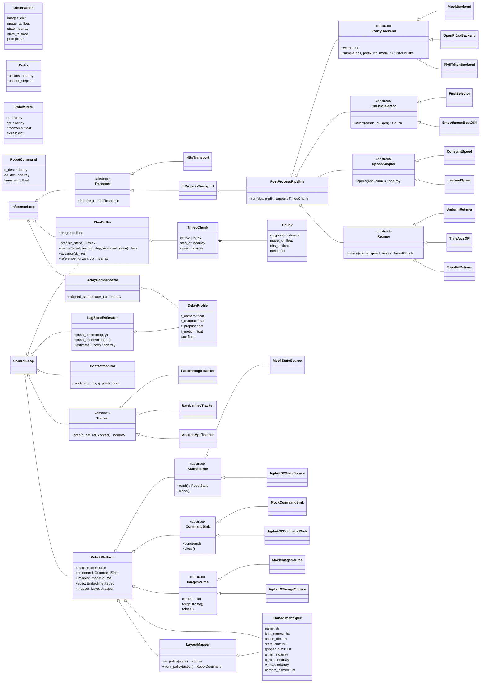

# fasterVLA 设计文档

> 状态：草案 v0.5。架构 / 接口 review 通过后，**下一优先实现：训练侧速度约束抽帧 + pi05（openpi JAX 包一层）**。
>
> 目标：让动作块（action chunk）VLA 在真机上**比示教更快、平滑、准确**地执行。
> 部署侧以 Realtime-VLA V2 为主线；训练侧先做 **关节速度约束下的跳帧 chunk**（SAIL 思路），经 openpi JAX 训 pi05。

## 0. 一页结论

- **仓库两大块**：`training/` 与 `deploy/`；共享放 `core/`。
- **本期训练优先**：在 pi05 数据加载里可选 **跳帧组 chunk**——连续做 `H` 次「单步最远合法跳」；\(\Delta t=1/H\) 秒；速度上限来自 YAML（`0.8/0.9/1.0·v_max`）；监督目标与现有 pi05 一致；训练循环 **包一层调用 openpi JAX**。
- **deploy 主线（后续）**：V2 标定 / 时间轴 / MPC / 推理时 inpaint RTC。
- **重定时**：先 A（server），接口预留 B。
- **机器人**：智元 G2、关节位置；P0 Mock；关节名 / SDK / URDF 待补（速度表先 YAML）。

### 0.1 已拍板

| # | 问题 | 决定 |
|---|---|---|
| 1 | 目标机器人 | **智元 G2**；通用 IO 接口先行，G2 / Mock / 其它机型同挂 `RobotPlatform` |
| 2 | RTC | P1 只做 **推理时 inpaint**；`PREFILL` → T3 |
| 3 | VLA 训练 | **openpi JAX** |
| 4 | 重定时位置 | **先 A（server）**，接口预留 B（client） |
| 5 | V2 代码怎么用 | **按新接口拆开重写、只搬算法** |
| 6 | G2 动作空间 | **关节位置命令**；关节名表 / SDK 文档待补充（不挡 P0 Mock） |
| 7 | 代码组织 | 顶层 **`training/`** / **`deploy/`** |
| 8 | 训练抽帧 | 数据加载内跳帧；`H` 次最远合法跳；\(\Delta t=1/H\)；YAML `v_max`；包 openpi JAX |

### 0.2 待补材料（不挡设计与 P0 Mock）

| 材料 | 用途 | 状态 |
|---|---|---|
| G2 关节名 / 维数 / 夹爪编码 | 填写 `EmbodimentSpec` + `LayoutMapper` | 待提供 |
| G2 Python SDK / 连接方式 | 实现 `AgibotG2StateSource` 等 | 待提供 |

## 1. 背景与原理映射

| 来源 | 原理 | 在本仓库的落点 |
|---|---|---|
| V2 §3 标定 | 图像 / 关节 / 跟踪延迟 | `core/calib/`；`deploy/client` 的 `DelayCompensator` |
| V2 §4.1 速度自适应 + 时间优化 | 只改 `step_dt`，不改路径 | `deploy/postprocess/speed.py`、`retime.py` |
| V2 §4.2 空间优化与跟踪 | 滞后回放 + acados MPC | `deploy/client/estimator.py`、`tracker/` |
| V2 §5 学习何时提速 | 人在回路油门 → 倍速回归 | `training/speed/`；`deploy/client/throttle.py` |
| V2 §7 上界分析 | motion / control bound | `deploy/analysis/`（P4） |
| RTC | 开推时冻前缀 | `deploy`：`INPAINT`；`training`：`PREFILL`→T3 |
| RACE §3.1 | 到达状态标签 | `training/data/reached_state.py` |
| RACE §3.3 | Best-of-N 选平滑 chunk | `deploy/postprocess/select.py` |
| SAIL 式抽帧 | 组 chunk 时按关节速度上限跳着选未来 `H` 步 | `training/resample/velocity_skip.py` + 数据加载钩子 |
| AWE / DemoSpeedup | 离线改写示教密度（可选，非本期） | `training/resample/` 其它插件 |
| 博客执行方案 L0–L5 | 倍速 1.0→1.2→1.5、开推时 inpaint | 第 7 节分期 |

## 2. 设计原则

1. **两大块清晰分界**：`training` 只产出数据集与 checkpoint；`deploy` 只消费它们做真机执行。标定配置、类型、协议放 `core`，两边共用。
2. **对模型透明（deploy）**：后处理只改时间轴或局部命令；RTC 前缀按模型步给出。
3. **模型步是唯一的尺子（deploy）**：计划缓冲 / 前缀 / 换段按模型步；真实时间只在重定时和控制环。
4. **可替换**：策略后端、后处理、执行、硬件、**示教重采样算法**均插件化 + YAML 注册。
5. **部署拓扑无关**：HTTP 远端与进程内同一套组件。
6. **速度轨与质量轨分开记录**。
7. **不 vendor 上游**：openpi JAX、V2 算法作参考；本仓库重写适配层。
8. **抽帧默认可关**：速度约束跳帧在 **dataloader 内**完成，不改磁盘上的原始示教；`skip_frames: false` 即标准 pi05 连续 `H` 步。

## 3. 系统架构

逻辑上只有两块：**training**（离线改数据 / 训模型）与 **deploy**（在线推理 + 控制）。下图是 deploy 运行时；training 数据流见 §3.3。

### 3.1 进程与模块（deploy）



- **server** 对应 V2 的「速度自适应 + 时间优化」，输出带时间的 chunk；**client** 对应「空间优化 + 跟踪 + 估计」。
- `Transport` 有两个实现：`HttpTransport`（远端 5090）和 `InProcessTransport`（Thor 单机，把 server 管线当库直接调用）。
- 重定时放在 server 侧（与 V2 一致）。如果以后要按实时状态重定时，`Retimer` 是纯函数，可以挪到 client，接口不变。

### 3.2 一次推理周期



### 3.3 训练侧数据流



抽帧发生在 **取 sample 时**，不先写一套抽稀数据集。`skip_frames: false` 时与标准 pi05 数据加载一致。

## 4. 仓库目录

两大包是硬边界：`training` 不 import `deploy.client` 的控制环；`deploy` 不依赖训练循环 / JAX。共享只走 `core`。

```text
fasterVLA/
├── pyproject.toml
├── docs/design.md
├── configs/
│   ├── training/                  # 对齐、抽帧、标签、速度模型、openpi 桥
│   ├── deploy/
│   │   ├── server/                # backend / selector / speed / retimer
│   │   └── client/                # io / delays / tracker / safety
│   └── embodiment/                # agibot_g2.yaml（待补关节名）等
├── src/fastervla/
│   ├── core/                      # 两边共用
│   │   ├── types.py               # Observation, Chunk, TimedChunk, Prefix, …
│   │   ├── config.py
│   │   ├── registry.py
│   │   ├── clock.py
│   │   ├── protocol.py            # InferRequest / InferResponse
│   │   └── calib/
│   │       ├── delays.py          # DelayProfile；标定算法
│   │       └── lag_model.py
│   │
│   ├── training/                  # ========== 训练 ==========
│   │   ├── data/
│   │   │   ├── align.py           # 按 DelayProfile 对齐（可选预处理）
│   │   │   ├── reached_state.py   # 命令 → 到达状态（可选）
│   │   │   └── limits.py          # 从 YAML 加载每关节 v_max（URDF 解析后接）
│   │   ├── resample/
│   │   │   ├── velocity_skip.py   # ★ H 次最远合法跳；Δt=1/H
│   │   │   └── offline/           # 可选离线插件（AWE 等，非本期）
│   │   ├── policy/
│   │   │   └── openpi_bridge.py   # 包一层：DataConfig + 跳帧采样钩子 + 调 openpi train
│   │   ├── speed/
│   │   └── cli.py
│   │
│   ├── deploy/                    # ========== 部署 ==========
│   │   ├── backends/              # PolicyBackend: mock / openpi_jax / triton可选
│   │   ├── postprocess/
│   │   │   ├── select.py
│   │   │   ├── speed.py
│   │   │   ├── retime.py
│   │   │   └── pipeline.py
│   │   ├── server/                # InferService
│   │   ├── transport.py
│   │   ├── client/
│   │   │   ├── io/                # StateSource / CommandSink / ImageSource
│   │   │   │   ├── types.py
│   │   │   │   ├── interfaces.py
│   │   │   │   ├── layout.py
│   │   │   │   ├── mock_sim.py
│   │   │   │   └── agibot_g2.py
│   │   │   ├── delay.py
│   │   │   ├── plan_buffer.py
│   │   │   ├── estimator.py
│   │   │   ├── contact.py
│   │   │   ├── tracker/
│   │   │   ├── safety.py
│   │   │   ├── throttle.py
│   │   │   ├── loops.py
│   │   │   ├── recorder.py
│   │   │   └── runtime.py
│   │   ├── analysis/              # 分段耗时、jerk、bound 判定
│   │   └── cli.py                 # fastervla-serve / -client / -calib
│   │
│   └── cli/                       # 薄封装，转发到 training.cli / deploy.cli
└── tests/
    ├── core/
    ├── training/                  # 含 resample 单测
    └── deploy/
```

## 5. 核心类型与接口

### 5.1 类图



### 5.2 关键契约

**`PolicyBackend.sample(obs, prefix, rtc_mode, n)`**

- 返回 `n` 条 `Chunk`，`waypoints` 为**绝对**关节量、已反归一化，长度为有效步数（已去掉前缀部分）。
- `rtc_mode`：`NONE` / `INPAINT` / `PREFILL`。**本期只实现并默认 `INPAINT`**（开推时软掩码冻前缀，不改训练）；`PREFILL` 接口保留到 T3。backend 声明自己支持的模式，不支持时启动即报错。
- `n > 1` 时观测编码只做一次，噪声在 batch 维扩成 `n`；墙钟应接近 `n=1`。这是 `SmoothnessBestOfN` 的前提。

**`ChunkSelector.select(cands, q0, qd0)`**

- `q0, qd0` 取前缀末端（即换段点的预期状态），不是开推时的观测。
- `SmoothnessBestOfN` 打分：以 `(q0, qd0)` 为边界做样条，\(J = s_{\mathrm{end}} / \int_0^{s_{\mathrm{end}}} \|q''\|^2 ds\)，取最大。`s_end` 对应的路点索引可配。

**`SpeedAdapter.speed(obs, chunk)`**

- 返回每步倍速 \(\kappa_i\)，用于生成参考时长 \(\Delta t_i^{ref} = \Delta t_{demo} / \kappa_i\)。
- `ConstantSpeed(κ)` 是 P1–P2 的默认；`LearnedSpeed` 读 `training/speed` 产出的模型，结果被 `κ_max`（相对示教的安全上限，如 3×）截断。

**`Retimer.retime(chunk, speed, limits)`**

- 只改 `step_dt`，不改 `waypoints`（时间轴优化不改路径）。
- `TimeAxisQP`：变量为 \(\Delta t_i^{-1}\)，目标 \(\lambda_0\sum\|\Delta t_i^{-1}-(\Delta t_i^{ref})^{-1}\|^2 + \lambda_1\|a_i\|^2\)，约束 \(\Delta t_{\min}\le\Delta t_i\le\Delta t_{\max}\)、\(v_i\le v_{\max}\)；OSQP 求解，失败时退回 `UniformRetimer`。
- 求解失败必须可观测（返回值里带 `status`，记日志），不能静默。

**`PlanBuffer`**

- 内部存「模型步路点 + 每步真实时长」。`progress` 是小数模型步。
- `prefix(n)`：从当前 `progress` 起取未来 `n` 个模型步，作为 RTC 前缀；记录 `anchor_step`。
- `merge(timed, anchor_step, executed_since)`：用实际已执行步数校准接入点，替换锚点之后的后缀；结果比当前计划更旧时丢弃并返回 `False`。
- `advance(dt_real)`：按当前段的 `step_dt` 把真实时间换算成模型步推进；接触模式下由 `ControlLoop` 传入 `alpha=0` 冻结进度。
- 线程安全：推理线程只调 `prefix` / `merge`，控制环只调 `advance` / `reference`，一把锁、临界区只做拷贝。

**`LagStateEstimator` / `Tracker`**

- 估计器：从最近一次关节反馈（时间戳已减 `t_proprio`）起，用 \(q_{k+1}=a q_k+(1-a)y_k\) 回放之后的命令，得到当前 \(\hat q\)；接触时直接返回最近观测，不外推。
- `AcadosMpcTracker`：目标与约束与 V2 §4.2 相同；SQP-RTI；求解超时或失败时降级为 `RateLimitedTracker`，并记一次事件。
- `ContactMonitor`：新息 \(\|q_{obs}-q_{pred}\|/\sqrt{n_q}\) 做 EMA，超阈值置位并至少保持 `hold_min` 拍；触发时 `v_max` 乘 `contact_v_scale`、进度冻结。

**夹爪**：夹爪维度不进 MPC，按 `gripper_lookahead_ms` 提前取未来指令（随倍速换算成模型步），与 V2 一致；`EmbodimentSpec.gripper_dims` 指明哪些维走这条旁路。

### 5.3 机器人 IO：本体无关接口（智元 G2 为首个实现）

控制环、RTC、重定时**不感知具体机型**。机型差异全部收在 `RobotPlatform` 里：读状态、发命令、取图像、以及「策略向量 ↔ 本体向量」的布局映射。

```text
ControlLoop / InferenceLoop
        │
        ▼
   RobotPlatform  ── EmbodimentSpec（关节名、维数、限位、相机名）
        │              LayoutMapper（to_policy / from_policy）
        ├── StateSource.read()   → RobotState(q, qd, ts, extras)
        ├── CommandSink.send()   ← RobotCommand(q_des, qd_des, ts)
        └── ImageSource.read()   → {cam_name: jpeg_bytes, timestamp}
```

| 接口 | 职责 | 不做的事 |
|---|---|---|
| `StateSource` | 读本体状态；时间戳尽量靠近硬件时钟 | 不做延迟补偿（交给 `DelayCompensator`） |
| `CommandSink` | 下发跟踪目标；失败抛错或返回状态码 | 不做轨迹规划 / 重定时 |
| `ImageSource` | 取多相机帧；`drop_frame` 清积压 | 不做人眼对齐、不编码策略输入 |
| `LayoutMapper` | 策略 D 维向量 ↔ 本体关节顺序 / 单位 | 不读写硬件 |
| `EmbodimentSpec` | 静态描述：关节名、夹爪维、限位、相机名 | — |

**实现路线**

| 实现 | 何时 | 说明 |
|---|---|---|
| `Mock*Source` | P0 必做 | 一阶滞后仿真被控对象；无硬件也能跑通异步 / RTC / 重定时 |
| `AgibotG2*` | 真机阶段 | 封装智元 G2 SDK；P0 可先 stub 方法签名 + 假数据，联调时再接真 SDK |
| 其它机型 | 按需 | 只新增 `StateSource` / `CommandSink` / `ImageSource` + 一份 `EmbodimentSpec` YAML，控制环零改动 |

**智元 G2 适配注意点（写进接口约定，避免以后塞进控制环）**

1. **布局**：G2 的关节顺序 / 单位 / 夹爪编码若与策略训练时不一致，只在 `LayoutMapper` 里转换；`PlanBuffer` 与策略始终用「策略布局」。
2. **状态扩展**：力矩、电流、末端位姿等放进 `RobotState.extras`，默认控制环不读；接触升级为真力信号时再接。
3. **命令模式（已拍板）**：第一版只下发 **关节位置**（CSP 类 setpoint）；`RobotCommand.q_des` 必填，`qd_des` 可选（给前馈 / 记录用）。若日后 G2 开放速度 / 力矩接口，用 `CommandSink` 能力标志声明，不改上层类型。
4. **多臂 / 躯干**：`EmbodimentSpec.joint_names` 按策略实际控制的自由度列出；未控关节由 `CommandSink` 内部保持安全姿态，不进策略维。
5. **材料未齐时**：`configs/embodiment/agibot_g2.yaml` 先放占位字段 + `TODO`；P0 只跑 `mock_sim`。关节名表与 SDK 到位后补 YAML 与 `AgibotG2*` 实现，控制环零改动。

YAML 示例（示意；关节名待文档补全）：

```yaml
robot:
  platform: mock_sim           # 真机阶段改为 agibot_g2
  embodiment: configs/embodiment/agibot_g2.yaml
  # embodiment 内待补：joint_names, gripper_dims, q_min/q_max/v_max, camera_names
  connection: {}               # G2 SDK 专有字段只放这里，不进 ControlLoop
```

### 5.4 重定时放 server 还是 client？（原问题 4）

**先分清两件不同的事**

| | 时间轴重定时 `Retimer` | 空间跟踪 `Tracker`（MPC） |
|---|---|---|
| 改什么 | 每个路点**多久走完**（`step_dt`） | 这一拍**发什么命令**才能跟上 |
| 路径形状 | **不变** | 可局部微调命令（预放大） |
| 要不要「现在的」机器人状态 | 经典 QP / 均匀缩放：**不要** | **要**（\(\hat q\)、接触） |
| V2 放哪 | server | client |

所以「重定时放哪」问的是：给路点分配时长这件事，在推理机上做完再下发，还是在机器人主机上、换段时再做。

**方案 A · 放 server（V2 默认，未拍板前按这个实现）**

```text
策略出 waypoints
  → SpeedAdapter 给每步 κ
  → Retimer 算出 step_dt
  → 网络下发 TimedChunk
  → client 只负责按时间表跟踪
```

- 优点：和 V2 一致；OSQP 跑在 GPU 机上；client 更轻；协议一次带齐时间表。
- 缺点：chunk 在路上飞的时候，机器人可能已经碰接触 / 油门变了；server 算时间表时看不到换段瞬间的 \(\dot q\)。接触降速靠 client 的 `ContactMonitor`（冻进度 + 降 `v_max`），**不再重算**整段 `step_dt`。

**方案 B · 放 client**

```text
策略出 waypoints（+ 可选速度建议）
  → 网络下发
  → 换段时用当前 q̂ / 接触 / 油门再 Retimer
  → 再跟踪
```

- 优点：时间表能吃到「此刻」的状态；以后若上 RACE 式 TOPP（需要当前速度作边界），自然落在这里。
- 缺点：工控机也要跑 OSQP；和 MPC 职责容易糊在一起；换段瞬间多一次求解延迟。

**和 RTC 的关系**：两种方案都不影响 RTC。前缀按**模型步**取，不按真实秒数取；`step_dt` 只影响「模型步推进有多快」。

**已拍板**：P0–P2 走 **方案 A**；`Retimer` 保持纯函数，YAML / 组装层可把同一实现挂到 client 的 `merge` 之后（预留 B）。需要当前速度边界（TOPP-RA / 油门热更新）时再切 B，不必改协议主路径。

### 5.5 协议

`InferRequest`：`images`（JPEG 字节）、`state`、`prefix`（模型步、绝对量）、`anchor_step`、`rtc_mode`（本期固定可走 `INPAINT`）、`kappa`、`request_ts`。
`InferResponse`：`waypoints`、`step_dt`（方案 A **必填**）、`speed`、`raw_waypoints`（重定时前）、`timing`（`encode / sample / select / retime` 分段毫秒）、`retime_status`。
编码用 msgpack，图像不经 base64。分段耗时直接用于速度轨记录。
预留 B：client 可忽略 server 的 `step_dt` 并本地重算覆盖。

## 6. 训练侧设计（`training/`）

### 6.1 本期优先：pi05 + 速度约束跳帧

```text
LeRobot / openpi 数据
  →（可选）DelayAlign / reached_state
  → DataLoader：每个 (t, obs) 取未来动作 chunk
        ├─ skip_frames=false：连续 [t+1 … t+H]（标准 pi05）
        └─ skip_frames=true ：H 次「最远合法跳」得到下标 i1…iH
  → openpi JAX：前向 → loss → 反向 → 优化器更新
```

`training/policy/openpi_bridge.py` **包一层**调用 openpi：复用其模型、loss、优化器与训练循环；本仓库只注入「如何取 action horizon」与配置。

### 6.2 跳帧算法（已拍板）

记动作 horizon 为 \(H\)，当前帧下标为 \(h_0=t\)，轨迹上关节（或与 pi05 监督同维的）配置为 \(q[\cdot]\)。

**时间步长（算速度用）**

\[
\Delta t = \frac{1}{H}\ \mathrm{s}
\]

（与「选项 B」一致：每选一步都按固定执行节拍算速度，跳得越远隐含速度越大。）

**单步合法**：从当前锚点 \(a\) 跳到候选 \(b>a\) 当且仅当 **所有关节** \(j\) 满足

\[
\frac{\bigl|q_j[b]-q_j[a]\bigr|}{\Delta t}
\le
s\cdot v_{\max,j}
\]

其中 \(s\in\{0.8,0.9,1.0\}\) 可配，\(v_{\max}\) 来自 YAML（URDF 解析后接同一字段）。

**组 chunk（连续做 \(H\) 次最远合法跳）**

```text
a ← h0
for k in 1..H:
  hx ← max{ b | a < b ≤ episode_end 且 (a→b) 对所有关节合法 }
  若无合法 b：hx ← min(a+1, episode_end)   # 至少前进一步，避免卡死
  i_k ← hx
  a ← hx
return q[i_1], …, q[i_H]   # 或对应 action 维，与现有 pi05 监督一致
```

- \(h_x=i_H\) 即约束下本 chunk 的最远终点。
- **监督目标与现有 pi05 一致**（同一 action 表示：绝对值 / delta 等由 openpi transforms 决定）；只换「选哪几帧」，不换 label 语义。
- 夹爪维：默认仍参与速度检查，或在 YAML 里把夹爪 \(v_{\max}\) 设很大 / 标 `ignore_velocity`；具体键名实现时定。

**速度表 YAML（先手写，URDF 明天再接）**

```yaml
# configs/training/joint_velocity_limits.yaml（示意）
joint_names: [j1, j2, ...]          # 与策略 action 关节维顺序一致
v_max: [1.0, 1.0, ...]              # rad/s
velocity_scale: 0.9                 # 0.8 / 0.9 / 1.0
ignore_velocity_dims: []            # 可选：夹爪下标
```

`training/data/limits.py`：读 YAML → `float[D]`；预留 `from_urdf(path) -> 同结构`。

### 6.3 延迟对齐 / 到达状态（可选，非跳帧阻塞项）

- `align.py`：按 `DelayProfile` 重配对（原集只读）。
- `reached_state`：监督改为实测到达状态；与跳帧可组合，但默认先跟现有 pi05 标签走。

### 6.4 openpi 桥（`training/policy/openpi_bridge.py`）

- 注册 / 包装 `DataConfig`，在构造 action sequence 处调用 `velocity_skip.build_chunk(...)`。
- 训练入口：调用 openpi JAX `scripts/train.py`（或等价 Python API），本仓库 CLI 只传配置。
- 不复制一份前向/反向实现；梯度更新逻辑以 openpi 为准。

### 6.5 速度自适应模型（`training/speed/`，后期）

人在回路油门日志 → 倍速回归；与跳帧抽帧独立。

## 7. 分期与验收

部署侧沿用博客方案的 P0–P4，训练侧新增 T0–T3。每期都要同时交速度轨（分段耗时 + 端到端任务时间 + 停顿占比）和质量轨（成功率 + 切换处 \(\max|\Delta a|\) / jerk + 跟踪误差）。

| 阶段 | 内容 | 通过标准 |
|---|---|---|
| P0 | `core` + `deploy` 骨架：协议、IO 抽象 + Mock、Mock 后端、同步 1×；G2 stub；calib 骨架 | mock 链路跑通；IO / LayoutMapper 契约单测通过 |
| P1 | `InferenceLoop` + `PlanBuffer` 异步；**推理时 inpaint RTC**；`DelayCompensator` | 停顿≈0；1.0× 成功率 ≥ 同步基线；切换 jerk 下降 |
| P2 | `TimeAxisQP` + `LagStateEstimator` + `AcadosMpcTracker`；κ=1.2 → 1.5 | 完成时间随 κ 下降；成功率 ≥ 基线；跟踪误差在阈值内 |
| P3 | `ContactMonitor` 收紧；`SmoothnessBestOfN`；评估 κ=2.0 | 精细阶段成功率不掉；切换 jerk 不恶化 |
| P4 | `LearnedSpeed` 上线；`analysis` 上界分析；可选 `ToppRaRetimer` | 相对 P3 同成功率下任务时间更短；多数段判为 motion bound |
| T0 | `velocity_skip` 单测 + YAML `v_max`；合成轨迹验证最远跳与多关节约束 | 见 §8；`skip_frames=false` 与连续 H 步一致 |
| T0b | `openpi_bridge`：能跑通一小步 pi05 训练（加载→前向→反向→更新）；可开关跳帧 | mock/小数据上 loss 有限、参数更新 |
| T1 | `Throttle` + `training/speed` | 回归稳定；干预次数下降 |
| T2 | `reached_state` A/B | 提频跟踪误差显著下降才默认开 |
| T3 | 训练时 RTC 前缀条件（`PREFILL`） | 仅 κ≥2 且 inpaint 仍不稳时做 |

提速不达标时，先用 nsys 做基线 vs 改动的 A/B，定位慢在哪一段再决定下一步。

## 8. 测试策略

测试在 review 通过后先于实现编写，放在 `tests/` 下，按被测模块组织。

| 层 | 要锁住的行为 | 方式 |
|---|---|---|
| `core` | 配置未知键 / 缺键报错；协议往返无损 | 单元 |
| `PlanBuffer` | 小数进度推进；前缀按模型步；延迟晚到的结果被丢弃；不同 κ 下接入点一致 | 单元，构造时间线 |
| `Retimer` | 路点不变；满足 \(\Delta t\) 上下界与 \(v_{\max}\)；求解失败降级且有状态 | 单元 + 随机路径性质测试 |
| `ChunkSelector` | 构造「平滑 / 急拐」两条候选，必选平滑那条 | 单元 |
| `LagStateEstimator` | 已知 τ 的仿真对象，回放估计误差小于阈值 | 单元 |
| `ContactMonitor` | 阻挡注入时触发、保持 `hold_min` 拍、释放后恢复 | 单元 |
| `DelayCompensator` / `align` | 给定已知延迟，取回的状态与真值对齐 | 单元 |
| `velocity_skip` | ① 全关节满足才采纳候选；② \(H\) 次跳后 `hx` 为最远合法；③ 调低 `velocity_scale` 则平均跨度下降；④ `skip_frames=false` ≡ 连续下标；⑤ \(\Delta t=1/H\) | 单元（合成轨迹） |
| `limits` | YAML 加载维数与顺序；缺键报错 | 单元 |
| `openpi_bridge` | 开关跳帧都能跑至少 1 step 训练 | 集成（可 GPU） |
| 端到端 deploy | Mock 后端 + Mock 平台，异步 + inpaint + 重定时：无停顿、无越界、切换 jerk 有界 | 集成（CPU） |
| IO | `LayoutMapper` 往返保形；G2 stub 契约；未知 platform 注册失败 | 单元 |
| backend | openpi JAX 与参考一致；batch=N 墙钟增幅有界 | 需 GPU，标记 `gpu` |

## 9. 依赖与运行环境

- Python 3.11+，uv；extras：`deploy-server`、`deploy-client`、`mpc`、`training`（openpi JAX、lerobot）、`triton`（可选）。
- **`deploy` 不依赖 JAX**；工控机只装 client extras。
- 配置 YAML + dataclass，未知键报错。
- 从 V2 搬算法保留 MIT 版权声明。

## 10. 材料待补

| 材料 | 用途 | 阻塞？ |
|---|---|---|
| 关节 `v_max` YAML（可先估） | 跳帧训练 | 有占位即可开测；真值后替换 |
| G2 URDF | 自动填 `v_max` | 不堵；解析器后接 `limits.from_urdf` |
| G2 关节名 / 策略维顺序 | `EmbodimentSpec` + `v_max` 对齐 | 训练跳帧需维顺序与 action 一致 |
| G2 Python SDK | `AgibotG2*` | 只堵真机 deploy，不堵训练抽帧 |

## 11. 理解确认（v0.5）

与你拍板一致：

1. \(\Delta t = 1/H\) 秒；速度用 \(|\Delta q|/\Delta t\)（固定节拍，跳得越远越快）。
2. 连续 \(H\) 次「单步最远合法跳」。
3. 监督与现有 pi05 相同，只换选帧。
4. 训练 = 包一层调 openpi JAX（数据加载钩子 + 配置）。
5. \(v_{\max}\) 先 YAML；URDF 明天再接。

**下一步（你点头后）**：先写 `tests/training/` 里 `velocity_skip` / `limits` 用例（先测试后编码），review 通过再实现与 `openpi_bridge`。
